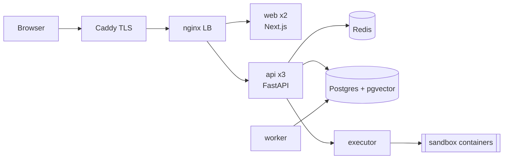

# Nexora — Think Beyond. Build Beyond.

An AI-assisted mentor for data structures, competitive programming and system design. It builds a model of what *you* know from
your real submissions, then tells you what to practise next, why, and how to get unstuck without giving the answer away.

[](../../actions/workflows/ci.yml)
[](../../actions/workflows/codeql.yml)


## What it does
| | |
|---|---|
| **Daily Challenge** | One problem chosen from your weak and due-for-revision patterns, with a measured holdout experiment (disclosed in Settings) that compares it against a rating-matched baseline. |
| **Interview crash course** | 30- or 60-day plans for DSA + system design: topic weights from your history, difficulty mix by level, mock/review days, catch-up when you slip. |
| **Interview Resources** | Company-wise DSA lists (470 companies, 3,396 distinct problems, tiers from FAANG to services) and a 70-question system-design library, by level. Community-reported data, labelled as such. |
| **System Design Lab** | Design *any* system: written plan (six HLD sections) + architecture canvas. A rule checker plus an AI mentor reviews it and teaches from your own gaps. |
| **AI Mentor** | Hint ladder (never the full answer first), retrieval over first-party notes, streamed answers, offline fallback when no model is configured. |
| **Coding Studio / Stress Tester** | C++/Python/Java/JS in network-less sandbox containers; the stress tester finds the smallest input where your solution and a brute force disagree. |
| **Pattern Universe, Revision, Mistake Notebook, Mock Interview, Practice Arena, Contests, Visualizer** | See [`docs/product/COMPLETE_FEATURE_INVENTORY.md`](docs/product/COMPLETE_FEATURE_INVENTORY.md). |
| **Browser extension** | Uploads the *verdicts* (never source code) of your own LeetCode submissions. Live-site compatibility is unverified; see [`extension/README.md`](extension/README.md). |

## Architecture
A small fleet of stateless processes behind a load balancer. Full write-up, failure behaviour and what was verified:
[`docs/architecture/distributed-system.md`](docs/architecture/distributed-system.md).



* **Backend** FastAPI · SQLAlchemy 2 · Alembic · Postgres 16 (+pgvector) · Redis · DB-backed job queue
* **Frontend** Next.js 16 · React 19 · react-three-fiber · Monaco · React Flow
* **Delivery** GitHub Actions CI/CD → GHCR images → SSH deploy with smoke test and automatic rollback

## Quick start

### Everything, the way production runs it (Docker)
```bash
cp .env.example .env            # set POSTGRES_PASSWORD, JWT_SECRET, EXECUTOR_KEY (generation commands are in the file)
mkdir -p /srv/nexora-work && chmod 777 /srv/nexora-work     # sandbox scratch dir, see docs/DEPLOYMENT.md
make up                         # 3 api + 2 web + worker + executor + Postgres + Redis + nginx  ->  http://localhost:8080
make smoke                      # end-to-end checks incl. replica spread and a sandboxed code run
make chaos                      # kill a replica / Redis / Postgres under load
make observe                    # + Prometheus and Grafana on :3001
```
LLM keys are optional: with none, the mentor answers from built-in notes. Add any of `GEMINI_API_KEY`, `GROQ_API_KEY`,
`OPENROUTER_API_KEY`, `ANTHROPIC_API_KEY` to `.env` (or run Ollama locally).

### Development (hot reload, SQLite)
```bash
make install
make dev-api      # http://localhost:18080  (docs at /docs)
make dev-web      # http://localhost:3000
make test         # backend + web + extension      make test-pg  # backend on Postgres + Redis
```
Load real data (admin user needed; promote one with `sqlite3 backend/dev.db "update users set role='admin' where email='you@example.com'"`):
`POST /catalog/sync/codeforces`, `POST /admin/sheets/import/neetcode`, and for company lists
`cd backend && PYTHONPATH=. python scripts/ingest_company_lists.py`.

## Repository layout
```
backend/      FastAPI app (app/), Alembic migrations, tests, scripts      web/        Next.js app
extension/    Chrome extension (verdict capture)                          deploy/     nginx, Caddy, Prometheus, Grafana, VM scripts
scripts/      smoke.sh, chaos.sh                                          docs/       architecture, product, API, security, runbooks
.github/      CI, CD, CodeQL, dependency audit, Dependabot
```

## Documentation
[Distributed system design](docs/architecture/distributed-system.md) · [Deployment](docs/DEPLOYMENT.md) ·
[Security](docs/SECURITY.md) · [Code-execution sandbox](docs/CODE_EXECUTION.md) · [API reference](docs/API.md) ·
[Interview resources & data provenance](docs/interview-resources.md) · [Testing](docs/TESTING.md) ·
[Roadmap and honest status](docs/ROADMAP.md)

## Honest status
Built and tested: everything in the table above. **Not done** (details in the roadmap): hosted-LLM verification of the design-review
quality (only a local 4B model was tried), human review of the 24 design notes, class-diagram canvas for low-level design,
measured effect of the crash course on learners, a load test of the distributed stack, redundancy of the data tier (one Postgres, one
Redis, one nginx), and a live GitHub Actions run (workflows are linted but were authored without being executed on GitHub).
The company-wise problem lists come from a community repository that declares no licence; decide whether to keep that source
before you publish a hosted instance ([`docs/interview-resources.md`](docs/interview-resources.md)).

## Contributing & security
[`CONTRIBUTING.md`](CONTRIBUTING.md) · report vulnerabilities per [`SECURITY.md`](SECURITY.md) · [MIT](LICENSE)
