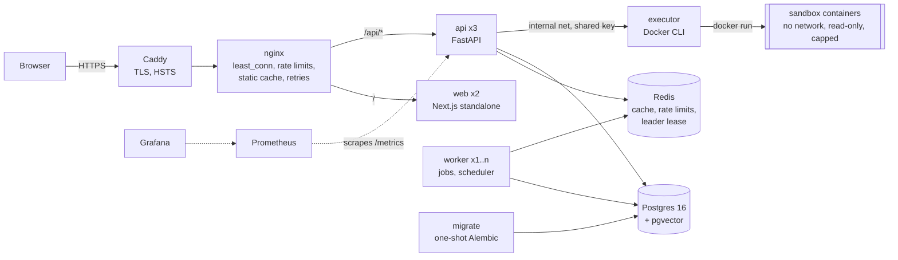

# Distributed system design

Nexora runs as a small fleet of stateless processes behind a load balancer. This page explains **what each piece is for, what
breaks when it fails, and what was actually verified**. Everything marked *verified* was run on this repo's compose stack
(`make up && make smoke && make chaos`); everything under *Not verified* was not.

## Design rules
1. **API replicas are stateless.** Sessions are JWT + a rotating refresh token in Postgres; nothing lives in process memory
   that another replica would need. Any replica can serve any request, so replicas can be added, killed or replaced freely.
2. **Redis is an optimisation, never a dependency.** It holds three disposable things: the shared rate-limit counters, the read
   cache and the scheduler's leader lease. With Redis absent or down the API falls back to per-process behaviour and keeps serving.
3. **Postgres is the only source of truth** and the only thing whose loss loses data.
4. **Untrusted code never runs next to the API.** Only the `executor` service touches a Docker daemon, on its own internal network.
   The API image has no Docker CLI and no socket.
5. **One thing does one job.** API replicas serve HTTP; workers run background jobs; a one-shot `migrate` container changes the schema.

## Components
| Piece | Why it exists | If it fails |
|---|---|---|
| **nginx** (`deploy/nginx/nginx.conf`) | Spreads requests (`least_conn`: AI and sandbox calls are slow, so new work goes to the least busy replica); re-resolves replicas through Docker DNS every 5 s so `--scale api=N` needs no config change; coarse per-IP limits (30 req/s API, 20/min on `/auth`); caches immutable `/_next/static` assets; retries *idempotent* requests on another replica after a connect error/502/503 (POSTs are never retried); keeps SSE un-buffered for streamed mentor answers. | Site down. Single instance in this design; see *Not verified*. |
| **api x3** | Stateless FastAPI. `/health` (liveness) is cheap; `/ready` checks the database and reports Redis as `degraded`, so a replica that cannot reach Postgres drops out of rotation without being restart-looped. | Others absorb its traffic. |
| **worker** | Drains the DB-backed job queue (platform syncs, backfills) and runs the periodic scheduler and notification ticks. | Background syncs pause; the user-facing site is unaffected. |
| **Redis** | See rule 2. LRU-evicted, no persistence by design. | Cache misses and per-replica rate limits until it returns; the client reconnects on its own (verified). |
| **Postgres** | Truth. `max_connections=200`; each process keeps a bounded pool (`CODEMIND_DB_POOL_SIZE` + `DB_MAX_OVERFLOW`, `pool_pre_ping`). | Writes and most reads fail; recovers when it returns (verified). |
| **executor** | The only place Docker runs. Authenticated by a shared key, internal network only. | Code runs/judging/stress tests return a clear 503; everything else works. |
| **migrate** | Schema changes run **once**, before API/worker start (`service_completed_successfully`). N replicas running `alembic upgrade` at boot would race. | Stack does not start (fails loudly rather than serving a half-migrated schema). |

## Correctness under concurrency (the parts that are easy to get wrong)
* **A background job runs exactly once.** Workers claim a job with an atomic `UPDATE ... WHERE status='queued'` and only the
  worker whose update touched one row runs it. A job left `running` by a crashed worker is reclaimed after 30 minutes (or marked
  `dead` once its attempts are exhausted). *Verified*: six racing claimers on real Postgres, exactly one wins.
* **Periodic work runs on one instance.** Without it, N workers would each send the same notification email. Leader election uses
  a Redis lease (`SET NX EX`, renewed with a compare-and-expire script) and, without Redis, a Postgres session advisory lock held
  on one dedicated connection (it disappears with the connection, so a crashed leader is replaced). If Redis *is configured but
  unreachable* **nobody** leads: a skipped tick is harmless, a duplicated email is not. *Verified* against real Redis and real Postgres.
* **Real client IP behind two proxies.** Caddy and nginx pass `X-Forwarded-For`; uvicorn runs with `--proxy-headers`, and nginx
  *overwrites* the header rather than appending, so a client cannot choose its own rate-limit identity. Without this every user would
  share the balancer's IP and one noisy user would exhaust everyone's login limit.
* **Cache correctness.** Only user-independent data is cached (tier counts, company lists, the design-question library). The per-user
  part (what *you* solved) is computed per request outside the cached function, and a test proves two users get different `you_solved`
  from the same cached payload. TTL is 5 minutes; the ingest job and the seed endpoint invalidate the `res:` prefix.

## What was verified (this machine, Docker Desktop, one host)
| Check | Result |
|---|---|
| Whole stack starts: db, redis, migrate (53 tables), 3 api, 2 web, worker, executor, lb | healthy |
| `scripts/smoke.sh` through the balancer | 15 checks pass, requests served by 3 distinct replicas, sandbox runs code via the executor (`6*7` -> `42`), smoke account deleted afterwards |
| Kill one API replica under steady load | 0 failures in 100 requests |
| Stop Redis under load | 0 failures in 73 requests; `/ready` reports `redis: degraded`; reconnects by itself |
| Restart Postgres under load | 5 failures in 175 requests (the single database was down); recovers, authenticated requests succeed after |
| Two workers | one leader lease in Redis, both drain the queue |
| Prometheus | scrapes all 3 replicas (`dns_sd`), Grafana dashboard provisioned |
| Backend tests | SQLite: 382 passed, 5 skipped (the skips need Postgres or Redis). Postgres 16 + real Redis: **387 passed, 0 skipped**, including the sandbox, concurrent-claim, advisory-lock and Redis tests |

These are one-machine correctness checks, **not capacity claims**: no load test on this stack has been run, so no requests-per-second
or concurrent-user number is claimed.

## Not verified / not built (honest list)
* **Single points of failure remain on one host:** one nginx, one Postgres, one Redis. The design makes the *stateless* tier
  redundant; making the data tier redundant (Postgres replica + failover, Redis Sentinel) is the next step and is not done.
* **Multi-host.** Compose runs on one machine. The same images and config map onto ECS/Kubernetes, but that has not been tried.
* **Zero-downtime schema changes.** Migrations are forward-only and run before the new code starts; a destructive migration would
  need an expand/contract split. Rollback restores the previous *images*, not the database.
* **Load, soak and failover-time testing**, Postgres/Redis exporters, alert rules, backups and a restore drill.
* **The executor shares a host with the stack by default.** The Docker socket is root on that machine. Production should run the
  executor on its own VM (`EXECUTOR_URL`); see `docs/CODE_EXECUTION.md`.
* **Multi-arch (arm64) images** are built only when the `MULTIARCH` repository variable is `true`; not tried.

## Scaling levers, in the order you would pull them
1. `API_REPLICAS` / `WEB_REPLICAS` / `WORKER_REPLICAS` (and `WEB_CONCURRENCY` per replica).
2. Raise cache TTLs on the endpoints Grafana shows as hot (cache hit ratio is a dashboard panel).
3. Move the executor to its own host(s); several executors behind the same URL work because each run is independent.
4. Add PgBouncer once `replicas x workers x (pool+overflow)` approaches Postgres' connection limit; then a read replica.
5. Move to a managed Postgres/Redis and a container platform.
